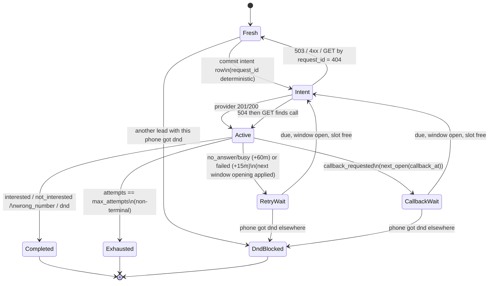

# Submission

## Candidate
- **Name:** Abhiram Santhosh
- **Assignment chosen:** B (Workflow)
- **Time spent (honest estimate):** ~5 focused hours (AI-assisted implementation; see `AI_USAGE.md`)

## How to run

```bash
# clean clone, Python 3.11+
python -m venv .venv && source .venv/bin/activate
pip install -r requirements.txt

# terminal 1 - the provider
cd assignment-b-workflow
python -m mock_telephony            # add --failure-scale 0 / --speed 1200 while developing

# terminal 2 - the dispatcher (from solution/)
cd solution
python -m campaign_dispatcher       # writes ./final_state.csv
pytest                              # 38 unit tests, fake clock, no network
```

`--db` (default `.dispatcher_state.db`) is the durable run state. **Do not delete
it between restarts**; that is what makes `kill -9` + restart work. Delete it
only to start a fresh run. `--output` controls where the CSV is written.

## Design

### Why a DB state machine, not Temporal

The workflow needs exactly three durable facts: *I intend to dial X*, *dial X
ended with Y*, and *the next action for X is due at T*. Those are rows. SQLite
in WAL mode with short `BEGIN IMMEDIATE` transactions gives commit-before-send
semantics with no extra service to run, and the whole safety argument fits on
one page. Temporal would add durable timers and activity retries, but the
provider's `request_id` idempotency already supplies the crucial at-most-once
primitive; the remaining work is scheduling, which is ordinary SQL + pure
functions. Temporal becomes the better choice at multi-worker scale (see "next").

### Lead state machine



Precedence on every finalisation: **completed > exhausted > dnd_blocked**. A lead
that used all three attempts and whose phone is later DND'd stays `exhausted`,
matching the provider's `/admin/leads` derivation.

### At-most-once dialling (the part that matters)

1. Pick a lead. Compute `attempt_no` from the number of **accepted** calls.
2. Build `request_id = au:<campaign>:<lead>:a<attempt_no>`. It is deterministic,
   so retrying the same logical attempt can never create a second call.
3. **Commit** an `intent` row (with the request id) to SQLite.
4. `POST /v1/calls`.
5. Record the 201/200 (`active`/`ended`).

The intent row is both a durable record and a **reservation**: while it is
unresolved it counts against tenant concurrency and locks the phone number. That
is what stops us from over-dialling after an ambiguous 504.

Crash analysis between the lines:

| Crash point | Recovery |
|---|---|
| before intent commit | nothing was sent; lead is still fresh |
| after commit, before POST | restart finds `intent`; `GET ?request_id=` → 404 → release + reschedule |
| during POST / socket loss | keep the intent, wait 5 real seconds, `GET ?request_id=`; adopt the call if it exists |
| after provider accepted, before we read 201 | same GET recovers the call (active or ended) |
| after webhook applied, before 201 read | webhook won the race; the 201 path detects `state=ended` and does not double-apply |
| after 201, before its DB write | intent row + GET recovers it; same deterministic id |
| mid-webhook | transaction rolls back; provider redelivers; polling also recovers |

The 5-second guard before declaring an uncertain intent "not placed" prevents the
one nasty race: a request still in flight at the provider after our client timed
out.

### Lost / duplicated webhooks

* Duplicates: `record_webhook` transitions the call to `ended` once, inside one
  transaction. Later copies see `state=ended` and return 2xx immediately.
* Lost: every tick polls `GET /v1/calls/{call_sid}` for calls we believe are
  active, and `GET /v1/calls?request_id=` for unresolved intents. "Ended" is only
  ever accepted from the provider, so concurrency slots are never freed on a
  guess.
* Signature: HMAC-SHA256 over the raw bytes, constant-time compare; bad
  signatures get 401.

### Dispatch loop

Each tick: reconcile → stop if every lead final → dial in priority order
(**due callbacks > due retries > fresh leads**) → short sleep. Eligibility is
checked against the provider's simulated clock, the campaign window ∩ the
09:00–21:00 regulatory window, the tenant-wide concurrency cap, the global
phone lock, the attempt cap and DND. The dispatcher uses the strict window (it
does not spend the provider's 120s grace), so clock drift cannot turn into a
window violation.

## Decisions & assumptions

| Decision | Why | Alternative considered |
|---|---|---|
| SQLite WAL + `synchronous=FULL` | Zero extra infrastructure; commit-before-POST is the whole safety proof | Temporal (more moving parts, not needed for one process) |
| Deterministic `request_id` from `(campaign, lead, attempt_no)` | Makes replay safe even if the DB row is lost or recreated | Random UUID persisted in the row (also works, more fragile) |
| An unresolved intent reserves a tenant slot + phone | A 504 may have placed a call; over-reserving causes lateness, under-reserving causes violations | Only reserve after 201 (risks 429/409 on ambiguous 504) |
| 5s real-time guard before treating an intent as not-placed | Closes the in-flight-request race after a crash | Trust a single GET immediately |
| 503 ⇒ not placed, drop intent | Documented as transient/no placement | Treat as ambiguous (slower, safe) |
| 504/timeout/5xx ⇒ ambiguous, keep intent | Outcome unknown | Assume placed/not placed (both wrong sometimes) |
| Poll active calls every ~80ms real | Recovers lost webhooks quickly; keeps slots accurate | Batched reconciliation or a reaper job |
| Strict window check, no grace exploitation | Grace is a provider tolerance, not a business allowance | Dial up to ±120s (riskier, no benefit) |
| Callback due = `next_open(callback_at)` | Exactly matches the provider's lateness metric | Dial at `callback_at` even if outside window (violation) |
| `exhausted` beats `dnd_blocked` | Matches the provider's own `/admin/leads` precedence | Treat DND as stronger (would mismatch) |
| Finish only when all leads final **and** no open calls | Prevents writing a CSV while a max-attempt call is still running | Finalise when leads are final (could race `/admin/leads`) |
| One process, webhook server in a thread | Simple; SQLite serialises writers with one lock | Separate webhook process + Postgres |
| CSV written atomically (tmp + rename) | A `kill -9` never leaves a half-written contract file | Write in place |

## Failure modes considered

Handled:

* **503** — released immediately; the same attempt is retried later with the
  same `request_id`.
* **Ambiguous 504** (before or after acceptance) — the intent stays reserved;
  `GET ?request_id=` decides. Both provider behaviours are covered.
* **Duplicate webhooks** — idempotent by `request_id`/`call_sid`; second copy
  returns 2xx without touching the lead.
* **Lost webhooks** — active calls are polled; ended calls are applied exactly
  once.
* **Webhook before the 201 response** — upsert by `request_id`; the later 201
  cannot resurrect the call.
* **`kill -9` at any point** — see the table above. Tested with six kills in a
  row.
* **Duplicate phone / DND** — a global phone lock and a persisted `dnd_phones`
  table; DND propagation finalises incomplete leads as `dnd_blocked`.
* **Bad signature / malformed body** — 401 / 400; provider retries.
* **Window boundary races** — re-read the simulated clock before each dial and
  use a strict window, while the provider tolerates 120s of skew.
* **Incomplete CSV** — `write_final_csv` refuses to write if any lead is not
  final.

Known gaps / not handled:

* **Provider restart mid-run** (simulated clock resets): we re-anchor the clock,
  but persisted absolute `pending_at` values would be in the future and the run
  would wait. A production design would use provider-relative deadlines or
  detect an epoch change and rebase.
* **Two dispatchers at once**: not implemented. SQLite serialises DB writes, but
  there is no cross-process reservation/lock, so two processes could both decide
  to dial. (The deterministic `request_id` still prevents double-dialling the
  same attempt, but it is not a supported mode.)
* **OS/power loss** is outside the test contract; WAL + `FULL` survives process
  kills, which is what is graded.
* **Machine clock skew vs the provider** is neutralised by anchoring on the
  provider's `sim_now` at sync time and measuring elapsed time with
  `time.monotonic()`.

## Testing

`cd solution && pytest` → **38 passed**.

Pure unit tests (no network, no sleeping, explicit fake datetimes):

* `tests/test_windows.py` — start-inclusive/end-exclusive, day-of-week filtering,
  regulatory intersection, next-open before/during/after close, weekend skipping,
  and "we do not exploit the provider's grace".
* `tests/test_scheduling.py` — 60m retry for `no_answer`/`busy`, 15m for `failed`,
  retries pushed to the next opening after close, callback inside/outside window,
  priority ordering (callback > retry > fresh, oldest-due first), attempt cap,
  DND, phone lock, tenant-wide concurrency, open-call exclusion.
* `tests/test_store_state_machine.py` — terminal completion, duplicate webhook
  idempotency, retry and callback scheduling, exhaustion on the third attempt,
  "callback on the last attempt is exhausted, not rescheduled", active-call
  finalisation guard, webhook-before-201, DND propagation across campaigns,
  `completed > exhausted > dnd_blocked` precedence, releasing an unresolved
  intent after DND, CSV sorting/columns.

End-to-end against the real mock (not part of `pytest`, run manually):

* `--failure-scale 0`, seed 7: 0 violations, 200/200 leads match `/admin/leads`.
* `--failure-scale 1`, seed 7 + **6 × `kill -9`**: 0 violations, 200/200 match,
  max concurrency seen exactly 4 (acme) / 3 (zen).
* `--failure-scale 1`, seed 99 + 1 × `kill -9`: 0 violations, 200/200 match,
  including one `dnd_blocked` lead caused by cross-campaign DND.

## Results

Representative `/admin/report` from the chaos run (seed 42, six `kill -9`s,
`failure-scale 1`, `--speed 1200`):

```json
{
  "calls_total": 408,
  "violation_count": 0,
  "violations_by_type": {},
  "max_concurrency_seen": {"acme_insurance": 4, "zen_retail": 3},
  "callback_lateness_minutes": {"count": 71, "p50": 16.8, "p90": 37.5, "max": 923.6},
  "webhooks": {"delivered": 432, "duplicates": 31, "connect_errors": 5, "lost": 7}
}
```

`final_state.csv` matched `/admin/leads` exactly (200/200 rows, all four fields).
The 923-minute callback outlier was caused by the deliberate ~19-simulated-hour
window in which the test harness kept killing the process; the clean seed-99 run
had p50 18.9 / p90 37.0 / max 61.0 minutes.

Callback lateness is the metric I optimised least. It is dominated by two
things that are not violations: (a) callbacks due near window close while all
of a tenant's slots are occupied by calls that are allowed to finish after
close, which correctly defer to the next opening, and (b) queueing behind the
tenant concurrency cap. A final 6000×-speed run (seed 7, failure-scale 1)
finished with 0 violations and 0 diffs but p50 116 / max 3820 minutes of
lateness, because in fast-forward a large backlog of due callbacks competes for
the same 4/3 slots. Reserving slots for imminent callbacks is the first thing
I would add (see below).

## If I had another day

1. **Distributed safety**: Postgres advisory locks or `SELECT ... FOR UPDATE
   SKIP LOCKED` on a `READY` queue table, so two dispatchers can share the work
   with the same guarantees. SQLite's single writer is the current limit.
2. **Callback lateness**: reserve a small number of tenant slots for imminent
   callbacks instead of filling every slot with fresh leads, and tighten the
   poll interval adaptively near a due callback.
3. **Provider clock epoch changes**: detect a changed `sim_epoch` and rebase
   stored `pending_at` values, so a provider restart does not stall the run.
4. **Observability**: emit structured JSON logs plus counters (dial intents,
   503/504, webhook duplicates/lost, reconciliation recoveries) and a Prometheus
   endpoint; `/status` exists but is deliberately minimal.
5. **Scale note (1M leads/day, 50 tenants)**: move to Postgres, shard the ready
   queue by tenant, keep scheduling as an indexed `(tenant, kind, due_at)`
   query, run N stateless dispatchers with row-level leases, and replace
   per-call polling with a webhook + periodic sweeper. The state machine and
   `request_id` scheme stay the same; only the storage and locking layer changes.
